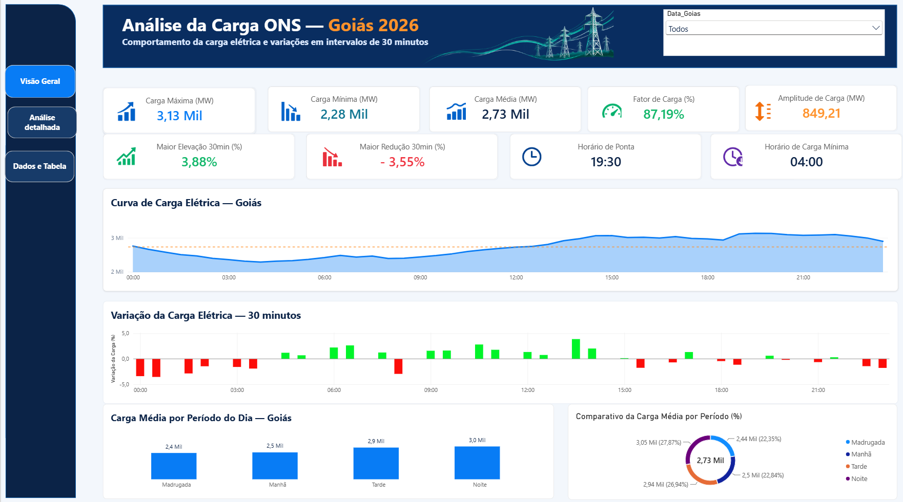
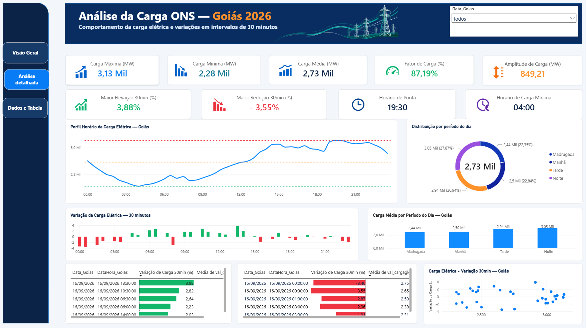
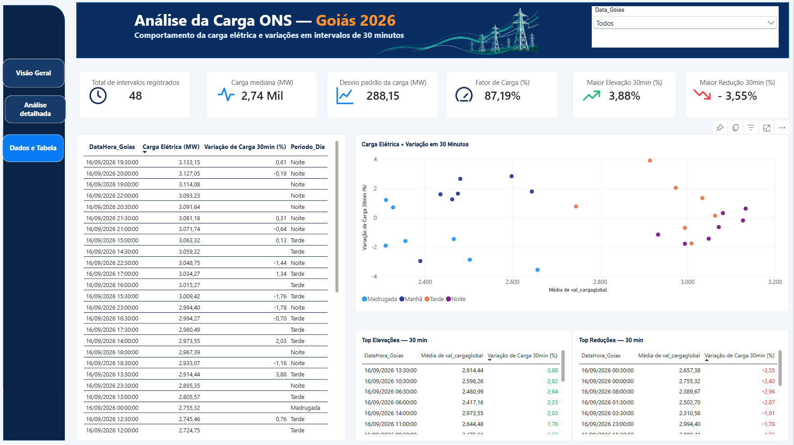

# ⚡ Análise da Carga Elétrica — Goiás 2026

### Dashboard Interativo | Power BI | Business Intelligence | Engenharia Elétrica

Projeto de Business Intelligence desenvolvido no Microsoft Power BI para análise do comportamento da carga elétrica no estado de Goiás, utilizando dados do **Operador Nacional do Sistema Elétrico (ONS)**.

O dashboard apresenta indicadores, análises de variação em intervalos de 30 minutos, gráficos interativos e navegação entre páginas, facilitando a interpretação dos dados e a identificação de padrões de consumo de energia elétrica.

---

## 🎯 Objetivo

Transformar dados do setor elétrico em informações claras, organizadas e acessíveis, permitindo analisar o comportamento da carga elétrica, identificar períodos de maior e menor demanda e compreender suas variações ao longo do dia.

## 🛠️ Tecnologias e ferramentas

- **Power BI:** desenvolvimento do dashboard e visualizações interativas.
- **DAX:** construção de medidas e indicadores analíticos.
- **Modelagem de dados:** organização dos dados para análise.
- **GitHub:** versionamento e documentação do projeto.
- **GitHub Pages:** publicação futura de uma versão web interativa.
## 📚 Documentação técnica

O projeto possui documentação específica sobre as medidas analíticas, as transformações realizadas no Power Query e a estrutura do modelo semântico.

- 📊 [Medidas DAX](MEDIDAS_DAX_revisado.md) — Indicadores, cálculos e expressões DAX utilizados no dashboard.
- 🔄 [Power Query](POWER_QUERY.md) — Conexão com a API do ONS, tratamento dos dados e adequação temporal.
- 🗂️ [Modelagem de Dados](MODELAGEM_DADOS.md) — Estrutura da tabela, colunas calculadas e organização do modelo semântico.
## 📊 Principais indicadores

O dashboard apresenta:

- Carga elétrica máxima, mínima e média (MW).
- Fator de carga (%).
- Amplitude de variação da carga (MW).
- Maior elevação da carga em 30 minutos (%).
- Maior redução da carga em 30 minutos (%).
- Horário de ponta e horário de carga mínima.
- Mediana e desvio-padrão da carga elétrica.
- Total de intervalos analisados.

## 🖥️ Estrutura do dashboard

### 1. Visão Geral

Apresenta os principais indicadores da carga elétrica, curva de carga diária, variações em intervalos de 30 minutos e comparativos entre os períodos do dia.

### 2. Análise Detalhada

Permite aprofundar a análise do perfil horário da carga elétrica, visualizar as oscilações e comparar o comportamento da demanda entre madrugada, manhã, tarde e noite.

### 3. Dados e Tabela

Disponibiliza registros detalhados, gráfico de dispersão e classificações das maiores elevações e reduções da carga elétrica.

## 🔎 Funcionalidades

- Navegação interativa entre as três páginas.
- Filtros por data.
- Gráficos e indicadores dinâmicos.
- Análise das variações positivas e negativas da carga.
- Comparação entre períodos do dia.
- Consulta aos registros utilizados nas análises.

## 📁 Fonte dos dados

**Operador Nacional do Sistema Elétrico (ONS)**

Fonte oficial: https://dados.ons.org.br/

Os dados utilizados no projeto são referentes à carga elétrica de Goiás. A documentação da base e dos procedimentos de tratamento será disponibilizada nas próximas atualizações.

## 🚀 Evolução do projeto

- [x] Desenvolvimento do dashboard no Power BI.
- [x] Criação de três páginas analíticas.
- [x] Implementação da navegação interativa.
- [x] Criação do repositório no GitHub.
- [ ] Inclusão das imagens do dashboard.
- [ ] Documentação das medidas DAX.
- [ ] Disponibilização da demonstração em vídeo.
- [ ] Desenvolvimento da versão HTML interativa.
- [ ] Publicação no GitHub Pages.

## 🖥️ Demonstração visual do dashboard

### 📊 Visão Geral

### 📈 Análise detalhada

### 📋 Dados e tabela

## 🎬 Demonstração em vídeo

Assista à demonstração do dashboard **Análise da Carga Elétrica — Goiás 2026**, desenvolvido no Power BI com dados do Operador Nacional do Sistema Elétrico (ONS).

O vídeo apresenta a navegação entre as três páginas analíticas, os principais indicadores e os recursos de visualização do projeto.

▶️ **[Clique aqui para assistir à demonstração completa](https://youtu.be/l17zwgMBU1M)**

**Projeto de portfólio em Engenharia Elétrica, Business Intelligence e Análise de Dados.**
